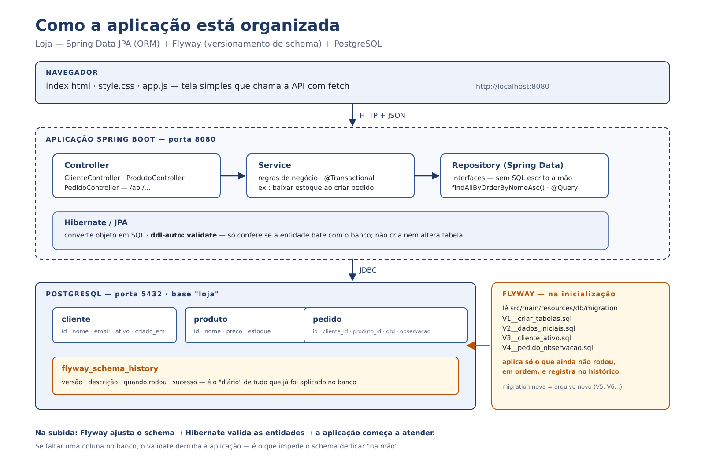

# Loja — Spring Data JPA (ORM) + Flyway (versionamento) + PostgreSQL

Projeto de apoio da aula de **Integração BD/RAD** — Banco de Dados II (UNOESC).

Usa **as mesmas tabelas do laboratório de PostgreSQL** (`cliente`, `produto`, `pedido`), com uma
diferença que é o assunto da aula: **quem cria e altera o schema é o Flyway**, não o Hibernate
e nem um script solto na pasta do banco.

Tem CRUD completo (clientes, produtos e pedidos) e uma interface simples em **HTML + CSS +
JavaScript puro** — sem framework de front — para o aluno ver o ORM funcionando de ponta a ponta.

## Como a aplicação está organizada



O caminho de uma requisição: o navegador chama `/api/...` → o **Controller** recebe → o **Service**
aplica a regra (`@Transactional`) → o **Repository** (Spring Data) conversa com o banco via
**Hibernate/JPA**. Em paralelo, na subida, o **Flyway** aplica as migrações pendentes e registra
tudo em `flyway_schema_history`.

## Atividade prática

O roteiro da atividade em sala está em **[docs/ATIVIDADE.md](docs/ATIVIDADE.md)**: acrescentar a
coluna `marca` no produto passando por migração → entidade → API → tela, mais dois desafios
(`categoria` com `DEFAULT` e o teste do checksum).

## A ideia em duas linhas

| Peça | O que faz |
|---|---|
| **Spring Data JPA (Hibernate)** | transforma classe em tabela e gera o SQL a partir do nome do método. **Não versiona schema.** |
| **Flyway** | aplica cada script `V1`, `V2`, `V3`... **uma única vez, na ordem**, e registra em `flyway_schema_history`. |

`ddl-auto: validate` está de propósito: o Hibernate só **confere** se a entidade bate com o banco.
Se o Flyway não criou a coluna, a aplicação **não sobe**. É a prova de que o schema não é
decidido pelo ORM.

## Como rodar

Pré-requisitos: **Java 17+**, **Maven** e **PostgreSQL instalado na máquina** (porta padrão 5432).

### 1. Criar o banco e o usuário (uma vez só)

No pgAdmin ou no terminal:

```bash
psql -U postgres -c "CREATE USER aluno WITH PASSWORD 'aluno123';"
psql -U postgres -c "CREATE DATABASE loja OWNER aluno;"
```

> No Windows, o `psql` fica em `C:\Program Files\PostgreSQL\18\bin`. Se o `postgres` pedir senha,
> é a senha que você definiu na instalação. Se o banco exigir senha na conexão local (`pg_hba.conf`),
> mantenha o método `scram-sha-256` — o usuário `aluno` já foi criado com senha.

### 2. Subir a aplicação

```bash
mvn spring-boot:run
```

Abra **http://localhost:8080** — a interface já lista os dados criados pelas migrações.
O Flyway roda as quatro migrações na primeira subida e registra em `flyway_schema_history`.

No IntelliJ: `File > Open` no `pom.xml`, espere baixar as dependências e rode `LojaApplication`.

Se o seu banco estiver em outra porta/host (ou com outro usuário), use variáveis de ambiente:

```bash
DB_PORT=5432 DB_USER=aluno DB_PASSWORD=aluno123 DB_NAME=loja mvn spring-boot:run
```

### Opcional: banco em container

Se preferir não instalar o PostgreSQL, há um `docker-compose.yml` que sobe o banco na mesma 5432.
Nesse caso, rode `docker compose up -d` antes de subir a aplicação.

## Importar no Eclipse

O projeto já está no formato que o Eclipse entende (**Maven**), com Java 17 e codificação UTF-8 configurada.

1. **File → Import… → Maven → Existing Maven Projects**
2. Em *Root Directory*, escolha a pasta do projeto (a que tem o `pom.xml`) → **Finish**
3. Espere o Eclipse baixar as dependências (barra de progresso no canto). Se marcar erro no `pom.xml`,
   clique com o botão direito no projeto → **Maven → Update Project** (ou `Alt+F5`) e marque *Force Update*.
4. Confira o Java: **Window → Preferences → Java → Installed JREs** precisa ter um **JDK 17 ou 21**
   (JRE 8/11 não roda Spring Boot 3).
5. Rode: botão direito em `LojaApplication.java` → **Run As → Java Application**.
6. Acesse **http://localhost:8080**.

Sem Eclipse "for Java EE" (sem o plugin Maven), instale por **Help → Eclipse Marketplace → "m2e"**.
Se os acentos aparecerem quebrados, em **Window → Preferences → General → Workspace → Text file encoding**
escolha **UTF-8** (o projeto já pede isso pelo `.settings`).

Pelo terminal, sem Maven instalado, use o wrapper que vem no repositório:

```bash
./mvnw spring-boot:run        # Linux/macOS
mvnw.cmd spring-boot:run      # Windows
```

> Antes de rodar, o banco `loja` e o usuário `aluno` precisam existir (seção anterior).
> O Flyway cria as tabelas na primeira subida — não é preciso rodar script nenhum na mão.

## API

| Método | Rota | O que faz |
|---|---|---|
| GET | `/api/clientes` | lista clientes |
| GET | `/api/clientes/{id}` | busca um cliente |
| POST | `/api/clientes` | cria — `{"nome":"...","email":"...","ativo":true}` |
| PUT | `/api/clientes/{id}` | atualiza |
| DELETE | `/api/clientes/{id}` | exclui (409 se tiver pedidos) |
| GET | `/api/produtos` | lista produtos |
| GET | `/api/produtos/sem-estoque` | consulta JPQL escrita à mão |
| POST/PUT/DELETE | `/api/produtos[/{id}]` | CRUD de produto |
| GET | `/api/pedidos` | pedidos com cliente e produto (`join fetch`) |
| GET | `/api/pedidos/resumo` | agregação por cliente (projeção) |
| POST | `/api/pedidos` | cria — `{"clienteId":1,"produtoId":2,"quantidade":3,"observacao":"..."}` |
| PUT/DELETE | `/api/pedidos/{id}` | atualiza / exclui (devolve o estoque) |

Erros saem no padrão **Problem Details** (`application/problem+json`), com `detail` em português
e, nos erros de validação, a lista `campos`.

## Roteiro para a aula (15–20 min)

1. **Suba tudo e abra a tela.** Os clientes/produtos/pedidos vieram do `V2__dados_iniciais.sql`:
   ninguém digitou `INSERT` no Java.
2. **Mostre o histórico no banco** (no pgAdmin ou no psql):
   ```bash
   psql -U aluno -d loja \
     -c "select installed_rank, version, description, success from flyway_schema_history order by installed_rank;"
   ```
   Quatro linhas: `1 criar tabelas`, `2 dados iniciais`, `3 cliente ativo`, `4 pedido observacao`.
3. **Evolua o schema:** crie `V5__produto_marca.sql` com
   `ALTER TABLE produto ADD COLUMN marca TEXT;`, acrescente `marca` na entidade `Produto` e
   reinicie. **Só a V5 roda** — as anteriores não repetem.
4. **Prove que o ORM não manda no schema:** adicione um campo na entidade **sem** criar a
   migração. A aplicação falha com `Schema-validation: missing column [...]`.
5. **Mostre o ORM no código:** `PedidoRepository.listarComClienteEProduto()` (JPQL com `join fetch`)
   e `resumoPorCliente()` (projeção com `count`, `sum` e `group by`) — o mesmo que se escreveria
   em SQL, mas com o mapeamento vindo das entidades.
6. **(Opcional) Regra de negócio dentro da transação:** criar um pedido baixa o estoque; excluir
   devolve. Se o estoque não der, a operação inteira é desfeita (`@Transactional`) e a API
   responde 409.

## Estrutura

```
docker-compose.yml                 # PostgreSQL 18 na porta 5433 (sem seed: o schema é do Flyway)
pom.xml
src/main/java/br/edu/unoesc/loja/
  LojaApplication.java
  domain/          Cliente.java · Produto.java · Pedido.java
  repository/      ClienteRepository · ProdutoRepository · PedidoRepository
  service/         ClienteService · ProdutoService · PedidoService
  web/             ClienteController · ProdutoController · PedidoController
  web/dto/         requests e responses (records) — a API não expõe entidade
  web/erro/        ApiExceptionHandler + exceções de domínio
src/main/resources/
  application.yml
  db/migration/    V1__criar_tabelas.sql · V2__dados_iniciais.sql
                   V3__cliente_ativo.sql · V4__pedido_observacao.sql
  static/          index.html · style.css · app.js
```

## Padrões adotados (e por quê)

**Banco**
- nomes em `snake_case`, tabelas no singular (`cliente`, `produto`, `pedido`);
- **todas as constraints nomeadas** (`pk_`, `fk_`, `uq_`, `ck_`) — o erro do banco fica legível;
- **índices nas FKs** (`idx_pedido_cliente`, `idx_pedido_produto`) — o PostgreSQL não cria sozinho;
- `ON DELETE RESTRICT` nas FKs: apagar cliente/produto com pedidos é bloqueado **no banco**,
  não só no código;
- `NUMERIC(10,2)` para dinheiro (nunca `float`), `CHECK` para preço/estoque/quantidade;
- comentários de tabela/coluna no dicionário (`COMMENT ON`).

**Código**
- entidade não sai na API: `Request`/`Response` como `record` + validação com Bean Validation;
- regra de negócio no `Service`, com `@Transactional`; controller só recebe e devolve;
- erros centralizados no `@RestControllerAdvice`, com status HTTP correto (400/404/409);
- dinheiro com `BigDecimal`; data/hora com `LocalDateTime` e `@CreationTimestamp`.

## Flyway x Liquibase

- **Flyway**: `V1__descricao.sql`, `V2__...sql` — SQL puro, simples de ler e de ensinar.
- **Liquibase**: changelog em YAML/XML, com rollback e `diff` entre bancos.

Os dois resolvem o mesmo problema: **aplicar cada mudança uma vez, na ordem, com registro**.
O que **não** é migração: `ddl-auto=update` do Hibernate.

## Credenciais do exemplo

Banco `loja`, usuário `aluno`, senha `aluno123` — só para o laboratório. Em projeto real,
use variáveis de ambiente e não versione senha.
